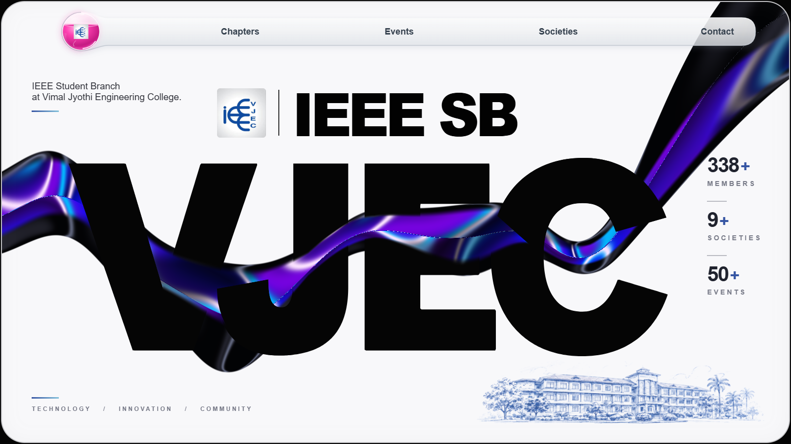

# IEEE SB VJEC

Responsive landing page for the IEEE Student Branch at Vimal Jyothi Engineering College.

## Run locally

Use Node.js 20.9 or newer.

```sh
npm install
npm run dev
```

Open http://localhost:3000. The landing page needs no database. If working on the optional Prisma models, copy `.env.example` to `.env` and run `npm run db:generate`.

## Build and run

```sh
npm run build
npm start
```

The build prepares Next.js standalone output and copies its static assets with a portable Node script. The commands work on Windows, macOS and Linux.

## Standalone preview

Open [`standalone/index.html`](standalone/index.html) directly in a browser. It includes the artwork and animations and needs no installation or server.

## Features

- Liquid glass menu adapted from the supplied animation: sliding orb, five color palettes, liquid trail, inertia and Contact-to-Home wrap.
- One connected black-chrome and blue/violet ribbon with pointer interaction.
- Elastic spring deformation applied only to VJEC lettering.
- Uploaded VJEC logo, 338+ members, 9+ societies and 50+ events.
- Responsive desktop, tablet and phone layouts, keyboard navigation and reduced-motion support.

Chapters, Events, Societies and Contact retain the original site's “Coming soon” feedback; separate content pages have not been added.

## Validation

Browser checks passed at 1600×900, 1024×768, 768×1024, 390×844, 320×568 and 844×390, with no horizontal overflow and menu targets at least 44×44 CSS pixels. Menu transitions, palettes, wrap, keyboard controls and reduced-motion behavior were verified in the Next.js app and standalone preview. The changed React files passed ESLint.

The inherited project configuration skips build-time TypeScript errors. Project-wide strict checking still reports existing issues in unused legacy liquid-logo/hidden-discoveries components and Prisma client setup; these are outside this landing-page update. A full production build has not been validated.

## Sources

Artwork and logo were supplied with the website. Ribbon rendering is adapted from the supplied `vjec-animation-source.txt` / `index (1).html`. Elastic physics originate from the supplied elastic-lettering package, preserved with its notices in `vendor-elastic`. The menu adapts the supplied Liquid Glass Navigation HTML.



[Mobile preview](docs/mobile.png)
